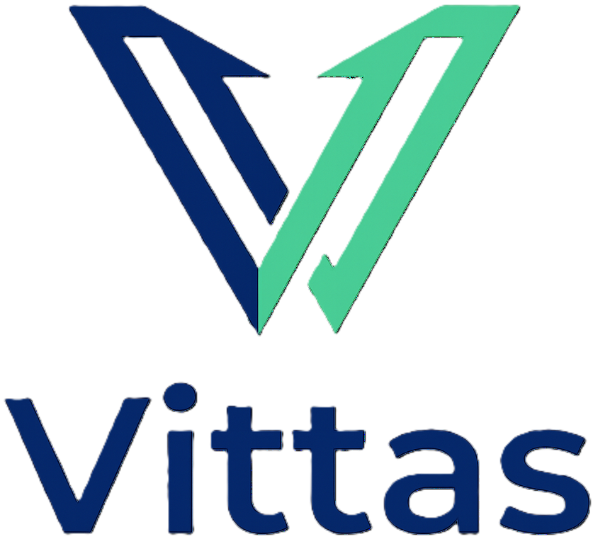
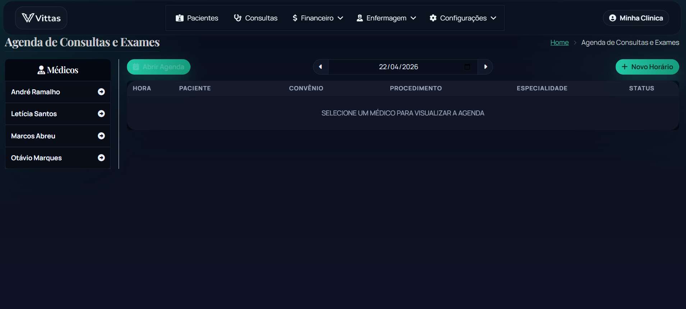
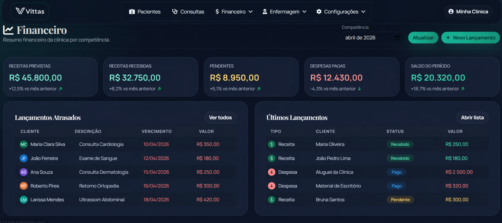

<p align="center">
  
</p>

<h1 align="center">Vittas</h1>

<p align="center">
  Sistema de gestão para clínicas médicas — agenda, pacientes, enfermagem e financeiro em um só lugar.
</p>

<p align="center">
  
  
  
  
  
</p>

---

## Sobre o projeto

O **Vittas** é uma aplicação web multi-clínica (multi-tenant) para o dia a dia de clínicas médicas.
Cada clínica tem seus próprios dados isolados, sua equipe de colaboradores com papéis e permissões
por módulo, e um histórico de auditoria de todas as alterações.

O projeto nasceu como uma migração de um sistema legado em PHP para uma stack moderna com
**Django + Tailwind CSS + Alpine.js**, renderizada no servidor e com interações leves no front-end.

> Este repositório é mantido como **portfólio / vitrine** do projeto.

## Modo visitante

Na tela de login, o botão **"Entrar como visitante"** dá acesso imediato, sem cadastro, a uma
clínica de demonstração populada com dados fictícios (pacientes, médicos, agenda, lançamentos…).

- **Somente leitura** — toda a navegação é liberada, mas qualquer alteração (criar, editar, excluir)
  é bloqueada no servidor por um middleware (`usuario/middleware.py`) e sinalizada na tela.
- **Dados sempre atuais** — a clínica de demonstração é criada no primeiro acesso e os dados
  fictícios são regenerados quando a agenda do dia ainda não existe.
- **Isolada** — a clínica do visitante e seus colaboradores não têm senha utilizável, então não é
  possível entrar nela por login comum (o que contornaria o modo somente leitura).

Para desativar, defina `DJANGO_MODO_VISITANTE=false`.

## Screenshots

| Agenda de consultas e exames | Dashboard financeiro |
| :---: | :---: |
|  |  |

## Funcionalidades

**Agenda**
- Agenda diária por médico para consultas e exames, com navegação por data
- Abertura de horários a partir da grade configurada de cada médico
- Início e finalização de atendimento, com status de agendamento configuráveis

**Pacientes**
- Cadastro completo com convênio, prontuário e endereço
- Preenchimento automático de endereço por CEP (via [BrasilAPI](https://brasilapi.com.br/))
- Registro de vacinas aplicadas

**Médicos**
- Cadastro com múltiplas especialidades
- Grade de horários de atendimento de cada médico

**Enfermagem**
- Fluxo de autorização de procedimentos (solicitação → aprovação → agendamento)
- Consulta de horários disponíveis e controle de realização/cancelamento
- Catálogo de procedimentos

**Financeiro**
- Dashboard por competência: receitas previstas e recebidas, pendências, despesas e saldo
- Lançamentos de receitas e despesas com baixa total ou parcial e cancelamento
- Categorias financeiras

**Administração**
- Cadastros auxiliares: convênios, especialidades, formas de pagamento, tipos de consulta/exame e status
- Gestão de equipe com papéis (Administrador, Recepção, Financeiro, Enfermagem, Médico)
- Controle de acesso por módulo, de acordo com o papel do colaborador
- Histórico de alterações em todos os registros com `django-simple-history`

## Arquitetura

```
ciil/          Configuração do projeto Django (settings, urls, wsgi/asgi)
usuario/       Autenticação, clínicas (tenant), colaboradores e permissões
base/          Cadastros compartilhados, multi-tenancy e serviços (CEP)
agenda/        Agenda de consultas e exames
paciente/      Pacientes e vacinas
medico/        Médicos, especialidades e grade de horários
enfermagem/    Autorizações, procedimentos e agendamentos de enfermagem
financeiro/    Lançamentos, categorias e dashboard financeiro
templates/     Layout base, menu e componentes globais (toast, diálogo de confirmação)
static/        CSS, JavaScript e imagens
```

Alguns pontos de destaque:

- **Multi-tenancy por clínica** — o modelo de usuário principal é a `Clinica`; colaboradores pertencem
  a uma clínica e todas as consultas são filtradas pelo tenant atual (`base/tenancy.py`).
- **Dois backends de autenticação** — login tanto da conta da clínica quanto de colaboradores
  (`usuario/auth_backends.py`).
- **Permissões por módulo** — mixins e decorators (`ClinicaModuloRequiredMixin`, `@modulo_requerido`)
  protegem cada área do sistema.
- **Modo visitante somente leitura** — middleware que bloqueia escritas na sessão do visitante,
  com exceções explícitas para consultas feitas via POST (`usuario/middleware.py`).
- **Componentes de UI reutilizáveis** — sistema global de toasts e diálogo de confirmação
  (veja [docs/TOAST_DIALOG_GUIDE.md](docs/TOAST_DIALOG_GUIDE.md)).

## Stack

| Camada | Tecnologias |
| --- | --- |
| Back-end | Python 3.12, Django 6, django-simple-history |
| Front-end | Django Templates, Tailwind CSS, DaisyUI, Alpine.js, Tom Select, Font Awesome |
| Banco de dados | SQLite (desenvolvimento) · PostgreSQL (produção) |
| Deploy | Gunicorn, WhiteNoise, Render |

## Como rodar localmente

Pré-requisito: **Python 3.12+**.

```bash
# 1. Clone o repositório
git clone https://github.com/Yan10Albuquerque/Vittas-.git
cd Vittas-

# 2. Crie e ative um ambiente virtual
python -m venv venv
source venv/bin/activate        # Windows: venv\Scripts\activate

# 3. Instale as dependências
pip install -r requirements.txt

# 4. Crie o banco (SQLite) e popule com dados de demonstração
python manage.py migrate
python manage.py seed_demo_data --clinic-email demo@vittas.com --create-clinic-if-missing

# 5. Suba o servidor
python manage.py runserver
```

Acesse <http://127.0.0.1:8000> e clique em **"Entrar como visitante"** (somente leitura), ou entre com
a clínica de demonstração para ter acesso completo:

| E-mail | Senha |
| --- | --- |
| `demo@vittas.com` | `Demo@123` |

> Em desenvolvimento nenhuma variável de ambiente é obrigatória. Para configurar o ambiente,
> copie [`.env.example`](.env.example) para `.env`.

## Testes

```bash
python manage.py test
```

Os testes rodam automaticamente a cada push pelo GitHub Actions
([.github/workflows/tests.yml](.github/workflows/tests.yml)).

## Deploy

O projeto está preparado para o [Render](https://render.com/):

- `build.sh` instala as dependências, coleta os arquivos estáticos e aplica as migrações;
- com `DJANGO_ENV=production` (ou `RENDER=true`), o `DEBUG` é desligado, o banco passa a ser
  PostgreSQL via `DATABASE_URL` e os estáticos são servidos comprimidos pelo WhiteNoise.

Start command sugerido: `gunicorn ciil.wsgi:application`.

## Autor

Desenvolvido por **Yan Albuquerque** — [GitHub](https://github.com/Yan10Albuquerque).
